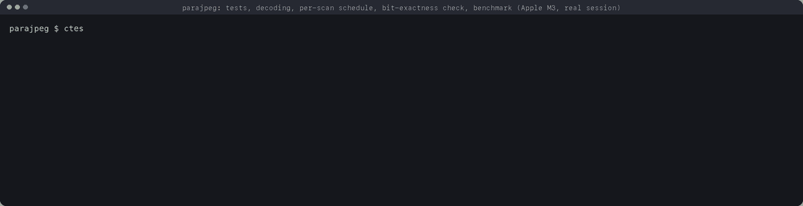
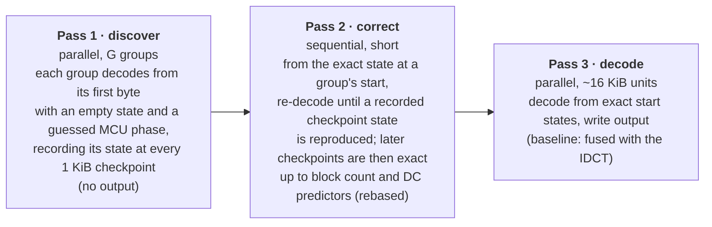
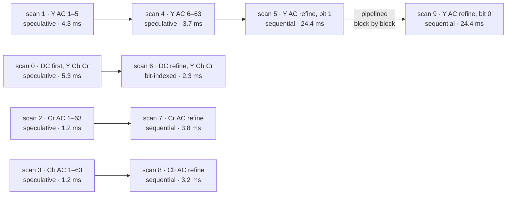
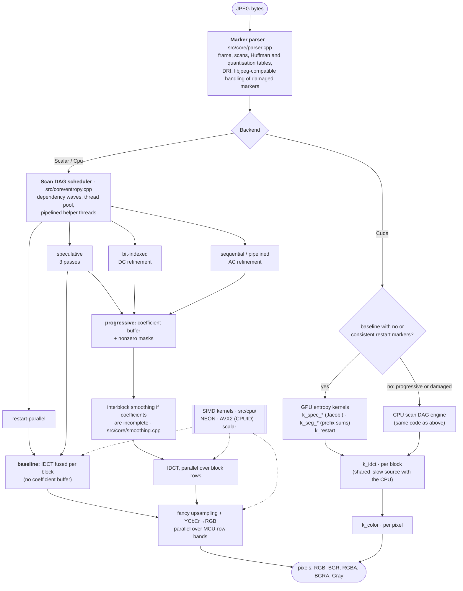
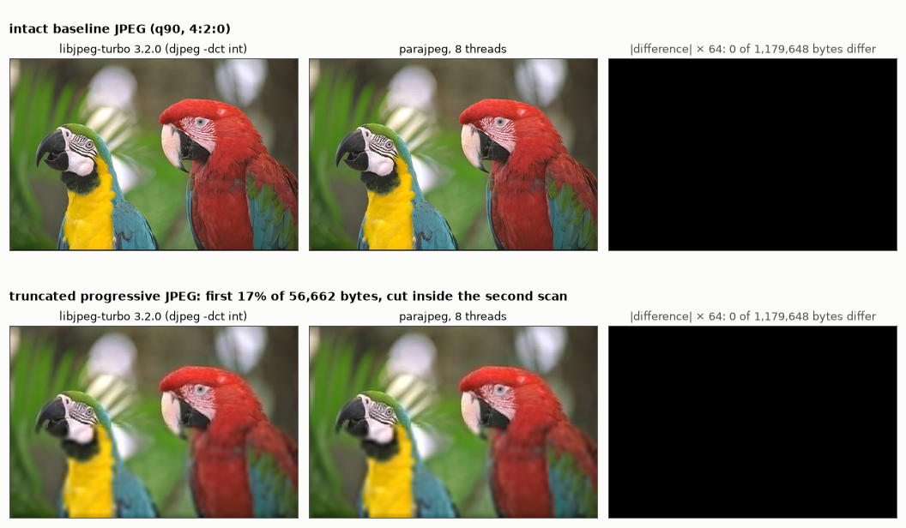

# parajpeg

**A parallel JPEG decoder whose output is byte-identical to libjpeg-turbo's, for images with or
without restart markers, and for progressive JPEG.** C++20, with scalar, multithreaded
NEON/AVX2 and CUDA backends.

[](https://github.com/anniigr/parajpeg/actions/workflows/ci.yml)

Huffman decoding is the part of JPEG decoding that resists parallelism: code boundaries are unknown
until everything before them has been decoded. libjpeg-turbo therefore decodes one image on one
core. parajpeg splits a single image across cores even when the file has no restart markers. The
threads start at arbitrary bytes and rely on the self-synchronisation of Huffman codes, and a
reconciliation pass makes the result exact. Progressive JPEGs are scheduled as a dependency graph of
scans. The pixels are identical to libjpeg-turbo's, which the test suite checks on every commit.

| | |
|---|---|
| **Output** | byte-identical to libjpeg-turbo 3.x with the accurate integer IDCT, for every backend, thread count and parallel strategy, including its recovery of truncated files |
| **Parallelism within one image** | restart intervals · speculative self-synchronising Huffman decoding when there are no restart markers · a scan dependency graph with pipelining for progressive JPEG |
| **Backends** | portable scalar C++20 · multithreaded with NEON (arm64) or AVX2 (x86-64, chosen at run time) · CUDA |
| **CUDA status** | compiles for sm_75–sm_120 and is bit-exact in a CPU grid emulator. **Not yet run on an NVIDIA GPU.** No GPU performance claims are made |
| **Measured speedup** (Apple M3, 12–21 MP photographs, vs single-threaded libjpeg-turbo 3.2.0) | 4.4–5.4× with restart markers · 2.8–3.1× without · 2.2–3.0× progressive |
| **Verification** | 70 images × 7 decoder configurations · 252 truncated streams · emulated GPU pipeline · SIMD equivalence · libFuzzer · ASan, UBSan, TSan in CI |
| **Scope** | 8-bit Huffman-coded JPEG (SOF0, SOF1, SOF2). Version 0.1.0: a research-grade library, not a drop-in libjpeg replacement |

<p align="center">
  
</p>
<p align="center"><sub>Real terminal session (<a href="bench/demo.sh"><code>bench/demo.sh</code></a>) on the Apple M3. <code>pjdec</code> decodes once in a fresh process,
so its timings include first-touch page faults; <code>pjbench</code> reports medians of warm decodes.</sub></p>

## Contents

1. [Why JPEG decoding is hard to parallelise](#1-why-jpeg-decoding-is-hard-to-parallelise)
2. [Speculative self-synchronising decoding](#2-speculative-self-synchronising-decoding)
3. [Progressive JPEG](#3-progressive-jpeg)
4. [Architecture](#4-architecture)
5. [Backends: scalar, NEON, AVX2, CUDA](#5-backends)
6. [Performance](#6-performance)
7. [Correctness](#7-correctness)
8. [Build and use](#8-build-and-use)
9. [Design decisions and trade-offs](#9-design-decisions-and-trade-offs)
10. [Limitations and future work](#10-limitations-and-future-work)
11. [References](#11-references)

Detailed documents: [design notes](docs/design.md) · [benchmarks](docs/benchmarks.md) ·
[correctness](docs/correctness.md) · [CUDA backend](docs/gpu.md)

## 1. Why JPEG decoding is hard to parallelise

A JPEG decoder has four stages:

1. Huffman (entropy) decoding of the coefficients of every 8×8 block.
2. Dequantisation and inverse DCT.
3. Chroma upsampling.
4. YCbCr→RGB conversion.

Stages 2–4 are independent per block or per pixel and parallelise trivially. Stage 1 does not: the
coefficients of the whole image (or of one progressive scan) form **one bitstream**, and cutting it
into chunks fails for several reasons at once:

```
 entropy-coded segment: one Huffman bitstream, codes of 1–16 bits, each followed by 0–11 extra bits
 ...0110 1110 0101 1111 1110 0001 0110 1100 1011 1111 1111 0000 0000 0110 1011...
                       ^
                       a second thread starts at this byte. It does not know:
                       - at which bit the next code begins             (variable-length codes)
                       - which coefficient (k = 0..63) comes next      (position inside the block)
                       - which component's tables apply                (position inside the MCU)
                       - the DC value of the previous block            (DC is coded as a difference)
                       - how many blocks a pending end-of-band run skips (progressive scans)
                       and FF 00 byte stuffing makes "bit position" ambiguous.
```

JPEG's own remedy is **restart markers**: byte-aligned markers after which decoding restarts from
a clean state, so the intervals between them are independent. Camera firmware often writes them.
Most other encoders, including libjpeg's `cjpeg` by default and most web images, do not.

**Progressive JPEG** adds a second kind of dependency. The image is sent as several scans: first
the DC coefficients, then bands of AC coefficients, then successive-approximation refinements that
add one bit of precision at a time. A coefficient is assembled across scans, and in a refinement
scan the number of bits a block consumes depends on that block's own history.

| | baseline | progressive |
|---|---|---|
| scans | usually one, all components interleaved | typically 6–10, each a DC or AC band of one or more components |
| per-block decoder state | position in block, MCU slot, DC predictor | the same, plus end-of-band runs; refinement depends on earlier scans |
| decodable from an arbitrary byte? | yes, after resynchronisation (§2) | first scans and DC refinement: yes · AC refinement: no (§3) |

## 2. Speculative self-synchronising decoding

**The observation.** Huffman codes self-synchronise (Klein and Wiseman, 2003). A decoder started at
an arbitrary bit decodes garbage for a while, then with high probability lands on a true code
boundary. From there on it emits exactly the symbols a decoder started at the beginning would emit.

For JPEG, being in step means agreeing on more than the bit position. parajpeg's synchronisation
key ([`DecoderState`](src/core/entropy.h)) is:

| field | meaning |
|---|---|
| `bitpos` | canonical bit position: absolute index of the next unread bit in the raw byte stream, independent of refill history and byte stuffing ([`BitReader::canonical_bitpos`](src/core/bitreader.h)) |
| `k` | next coefficient index inside the current block (0 = at a block boundary) |
| `slot` | block position inside the interleaved MCU, which selects the component and its tables |
| `eobrun` | remaining end-of-band run (progressive AC first scans) |

Two decoders with equal keys decode the rest of the scan identically. The block count and the DC
predictors are bookkeeping that can be rebased once the true starting point is known.

**The CPU algorithm** ([`decode_speculative`](src/core/entropy.cpp)) cuts the scan into
checkpoints every K = 1 KiB and groups them into G = 4 × threads groups:



Correctness does not depend on synchronisation actually happening. If a group's recorded states
are never reproduced, pass 2 simply decodes that whole group sequentially, and the output is still
exact. Synchronisation only decides how much work stays sequential: about G × (distance to
synchronisation).

**How far is "a while"?** Rather than assume it, `pjsyncdist` measures it on 72,000 random start
positions in 36 photographs:

<picture>
  <source media="(prefers-color-scheme: dark)" srcset="docs/img/syncdist-dark.png">
  
</picture>

<sub>Bytes decoded from a random start until the decoder's state equals the true state, measured at
block boundaries. 12 NASA re-encodings and 24 Kodak images, baseline without restart markers,
Apple M3. Data: [`bench/results/syncdist.md`](bench/results/syncdist.md).</sub>

The bit position aligns within a few dozen bytes. Synchronising the **MCU phase** takes 6–15 times
longer for 4:2:0 scans: with four luma and two chroma blocks per MCU, a decoder in the wrong slot
keeps producing plausible symbols. The 1 KiB CPU checkpoint covers the 99th percentile for 23 of
the 36 images, so pass 2 typically re-decodes one checkpoint per group. In the trace of a 21 MP 4:2:0
image, 31 groups needed 31 re-decoded checkpoints.

**Cost model.** Passes 1 and 3 both perform the Huffman work, so the entropy stage does about twice
the sequential work, spread over P threads. The ceiling is therefore about P/2, plus a sequential
term of G × K bytes. With two threads speculation only breaks even, so the scheduler enables it
from three threads up; the benchmarks confirm that threshold (§6). Memory overhead is two small
state arrays per checkpoint, and no extra coefficient storage.

**On the GPU** the trade-off is reversed: thousands of threads, each owning a 256-byte subsequence,
synchronise by Jacobi iteration. Each thread re-decodes its subsequence from its left neighbour's
latest end state until nothing changes, following Weißenberger and Schmidt (HiPC 2021). parajpeg
extends their state with the MCU slot for interleaved scans. Details and caveats are in §5 and in
[docs/gpu.md](docs/gpu.md).

## 3. Progressive JPEG

parajpeg treats the scans of a progressive image as a **dependency graph**. Two scans conflict if
they touch a common coefficient. Two AC scans of the same component also always conflict, because
they share per-block bitmasks (below). Each scan type gets its own strategy:

| scan type | strategy | why |
|---|---|---|
| DC first | speculative (§2) | bit consumption depends only on the MCU phase |
| AC first | speculative, state includes `eobrun` | independent of a block's history |
| DC refinement | **bit-indexed**: block *n* reads bit *n* | exactly one bit per block, so after removing byte stuffing the position is known |
| AC refinement | sequential, **pipelined** behind its predecessor | see below |
| any scan with restart markers | restart-parallel | intervals are independent |

This is the actual schedule `pjdec` reports (`PJ_SCANS=1`) for a 21 MP image encoded with
`cjpeg -progressive`. Arrows are dependencies to the nearest conflicting scan. Scans in the same
wave run concurrently:



<sub>Wave 0: scans 0–3 · wave 1: scans 4, 6, 7, 8 · wave 2: scan 5 · wave 3: scan 9. Times are
per-scan wall times from a single cold 8-thread decode; scans 5 and 9 overlap almost completely.</sub>

**Why AC refinement stays sequential.** In a refinement scan, each block reads one correction bit
for every coefficient that is already nonzero, interleaved with codes for newly nonzero ones.
How many bits a block consumes therefore depends on the values that earlier scans produced for
*that particular block*. A decoder that starts at an unknown position does not know which block it
is in, so it cannot decode at all, and resynchronisation does not help. This is an argument from
the format, verified empirically, not a formal proof. It does not exclude other approaches, for
example speculating on the block index as well.

**What is done instead:**

* **Nonzero bitmasks.** Each block carries a 64-bit mask of nonzero coefficients in zig-zag order.
  Refinement finds the next zero-history position with popcount/clear-lowest-bit operations and
  reads correction bits in batches of up to 16, instead of walking all 63 positions as libjpeg
  does. This alone makes single-threaded progressive decoding 1.1–1.35× faster than
  libjpeg-turbo.
* **Pipelining.** Dependent sequential scans with the same block order run concurrently. Each
  publishes its progress with a release store. A successor may decode block *b* once its
  predecessors have passed *b* (acquire load). Dependencies always point to earlier scans and the
  main thread runs its scans in index order, so the scheme cannot deadlock. Pipelining took the
  best progressive time from 47.5 ms to 34.0 ms on the image above.

The pipeline is lock-free and runs clean under ThreadSanitizer. One data race did occur during
development: two scans on disjoint bands of one component raced on the shared mask word. A failing
bit-exactness test exposed it, and the "same-component AC scans conflict" rule now rules it out.

## 4. Architecture



| path | role |
|---|---|
| [`include/parajpeg/parajpeg.h`](include/parajpeg/parajpeg.h) | public API: `read_header`, `decode`, `decode_into`, options and per-scan statistics |
| [`src/core/parser.cpp`](src/core/parser.cpp) | marker parser, Huffman table construction with an 11-bit lookup and a combined code+value fast path for AC symbols |
| [`src/core/bitreader.h`](src/core/bitreader.h) | bit reader that can start at any byte, with canonical bit positions and libjpeg's end-of-data semantics |
| [`src/core/entropy.cpp`](src/core/entropy.cpp) | scan DAG scheduler and the sequential, restart-parallel, speculative, bit-indexed and pipelined decoders |
| [`src/core/smoothing.cpp`](src/core/smoothing.cpp) | libjpeg-turbo's interblock smoothing for progressive images with incomplete coefficients |
| [`src/core/decoder.cpp`](src/core/decoder.cpp) | orchestration: buffers, fused or separate IDCT, parallel colour stage, statistics |
| [`src/common/idct_core.h`](src/common/idct_core.h) | libjpeg's islow IDCT, shared by the CPU and the CUDA kernels |
| [`src/cpu/`](src/cpu) | NEON and AVX2 kernels, runtime dispatch |
| [`src/cuda/`](src/cuda) | CUDA kernels and host pipeline; runtime shim that also targets the CPU grid emulator |

## 5. Backends

| backend | entropy decoding | IDCT, upsampling, colour | status |
|---|---|---|---|
| `Scalar` | sequential | portable C++, 64-bit IDCT intermediates (libjpeg's `JLONG`) | reference implementation; tested |
| `Cpu` | all strategies above, thread pool | NEON or AVX2, parallel over rows | tested on arm64 (NEON) and x86-64 (AVX2, GCC) in CI |
| `Cuda` | GPU kernels for baseline; CPU engine for progressive | GPU kernels | compiled in CI; algorithm verified in the emulator; **never executed on a GPU** |
| `Auto` | `Cuda` if compiled in and a device is present, otherwise `Cpu` | | |

**NEON and AVX2.** The IDCT kernels reproduce libjpeg's integer arithmetic exactly in 32-bit
lanes. This is safe because, when every input of a 1-D pass satisfies |x| ≤ 2¹⁴, no intermediate
can exceed about 1.8·10⁹ < 2³¹. Each pass checks that bound, and the final stage checks that values
lie in the range-limit window [−512, 511]. A block that fails a check takes the 64-bit scalar
path, so the SIMD kernels are exact for *all* inputs, adversarial ones included. The NEON colour
conversion splits libjpeg's fixed-point constants (for example `FIX(1.402) = 65536 + 26345`), so that 16×16→32-bit
products with rounding shifts reproduce `jdcolor.c` bit for bit. The AVX2 kernels use
function-level `target` attributes and are selected by CPUID, so the library runs on any x86-64
CPU. `PARAJPEG_FORCE_SIMD=scalar|avx2` overrides the choice for testing.

**CUDA.** One thread per 256-byte subsequence runs the speculative decode (`k_spec_init`), then
Jacobi rounds (`k_spec_iter`) until no state changes. Sync-free segmented prefix sums (`k_seg_*`)
turn per-subsequence block counts and DC sums into absolute offsets and predictors, and a final
decode (`k_spec_write`) writes the coefficients. Restart intervals get one thread each
(`k_restart`). The IDCT runs one thread per block and the colour stage one thread per output pixel.
The kernels avoid shared memory and `__syncthreads`, so the identical source runs in a sequential
CPU grid emulator, and the GPU algorithm passes the same bit-exactness tests on any machine.

> **CUDA status, stated plainly.** CI compiles `gpu_decoder.cu` with CUDA 13 for sm_75, 80, 86,
> 89, 90, 100 and 120. ptxas reports 31–40 registers for the entropy kernels and 92 for the 64-bit
> IDCT. The kernels have **not been run on NVIDIA hardware**: there is no GPU performance number and
> no on-device correctness result in this repository. The emulator also exposed a tuning problem.
> With 256-byte subsequences, 4:2:0 images need 3–15 Jacobi rounds, against 1–2 for 4:4:4,
> because MCU-phase synchronisation takes longer than a subsequence (§2). The plan for the first
> hardware session (nvJPEG comparison, compute-sanitizer, Nsight Systems/Compute, subsequence
> tuning) is in [docs/gpu.md](docs/gpu.md#5-plan-for-the-first-hardware-session).

## 6. Performance

**Setup:** MacBook Air with Apple M3 (4 performance + 4 efficiency cores, 16 GB), macOS 27,
Apple clang 21 `-O3`, NEON. The baseline is libjpeg-turbo 3.2.0 via TurboJPEG with
`TJFLAG_ACCURATEDCT`, single-threaded, decoding to RGB in both libraries. Each figure is the
median of 15 complete decodes after a warm-up. Images: four public-domain NASA photographs (three
at 20.7 MP, one at 12.2 MP), as distributed plus five re-encodings each. Full methodology and every
number: [docs/benchmarks.md](docs/benchmarks.md).

<picture>
  <source media="(prefers-color-scheme: dark)" srcset="docs/img/speedup-dark.png">
  
</picture>

| 21 MP image (iss062e001866) | libjpeg-turbo | parajpeg, 1 thread | parajpeg, 8 threads | speedup |
|---|---:|---:|---:|---:|
| camera original (4:4:4, restart marker every MCU row) | 41.98 ms | 45.19 ms | 9.10 ms | 4.6× |
| q85 4:2:0, restart marker every MCU row | 37.03 ms | 40.51 ms | 8.41 ms | 4.4× |
| q90 4:2:0, no restart markers | 33.02 ms | 38.63 ms | 11.49 ms | 2.9× |
| q90 4:4:4, no restart markers | 41.97 ms | 45.76 ms | 14.41 ms | 2.9× |
| q85 progressive (10 scans) | 100.99 ms | 74.99 ms | 33.97 ms (2 threads) | 3.0× |

<picture>
  <source media="(prefers-color-scheme: dark)" srcset="docs/img/scaling-dark.png">
  
</picture>

What the numbers mean:

* **Restart markers** scale almost linearly, up to 2.3 gigapixels/s on the 21 MP camera originals.
  Going from 4 to 8 threads adds efficiency cores, so the last step is smaller.
* **Without markers**, 2 threads gain nothing, by design: speculation is switched off below three
  threads. At 8 threads the speedup is 2.8–3.1×, close to the P/2 ceiling of decoding twice.
* **Progressive** images are limited by the luma AC-refinement chain (§3). They peak at 2 threads,
  and more threads add contention rather than speed.
* **Single-thread efficiency:** 0–15% slower than libjpeg-turbo on baseline images, 9–35% faster on
  progressive ones.
* **Many small images, one per core** (24 Kodak images, 8 workers): 0.94× of libjpeg-turbo's
  throughput. This is the data-loader case where parallelism inside an image does not apply, so
  parajpeg has no advantage there.

These are latency results for **one image at a time**. A server or data loader that keeps every
core busy with its own image gains nothing from intra-image parallelism. In that setting
libjpeg-turbo (or nvJPEG on a GPU) is the right comparison, and parajpeg is slightly slower.

## 7. Correctness

<picture>
  <source media="(prefers-color-scheme: dark)" srcset="docs/img/bitexact-dark.png">
  
</picture>

<sub>Real decodes generated by [`bench/figure_bitexact.py`](bench/figure_bitexact.py). The figure
illustrates; the proof is the byte comparison it prints (0 of 1,179,648 bytes differ in both rows)
and the test suite below. Bottom row: the file is cut inside its second scan, so the lower part of
the image has only DC coefficients, which libjpeg-turbo smooths. parajpeg reproduces that recovery
exactly.</sub>

| check | scope | in CI |
|---|---|---|
| byte-for-byte vs TurboJPEG | 70 corpus images (odd sizes, 4:4:4/4:2:2/4:2:0/4:4:0/4:1:1, grayscale, restart intervals, optimised tables, progressive) × 7 configurations: scalar, 1/8 threads, forced parallel strategies at 2/3/8 threads with 64–256 B subsequences, BGRA | Linux x86-64 (AVX2), macOS arm64 (NEON) |
| strategies really used | with forced parallelism, every scan that can be parallel must report a parallel strategy | yes |
| CUDA algorithm | CUDA source in the CPU grid emulator: whole corpus in RGB and BGRA, and with 32 B subsequences | yes |
| damaged data | 252 truncated streams vs libjpeg-turbo's recovery output, 5 decoder variants each, including the emulated GPU | yes |
| SIMD | 200,000 random and adversarial blocks per run, NEON and AVX2 vs the 64-bit scalar reference | yes |
| robustness | random corruption and truncation; libFuzzer with ASan + UBSan (two real bugs found, both now regression tests) | yes |
| memory, UB, races | ASan + UBSan, ThreadSanitizer over the full suite | yes |
| large real files | 48 benchmark files at 1 and 8 threads vs `djpeg`: `96 identical, 0 different` | local ([`bench/check_bitexact.sh`](bench/check_bitexact.sh)) |

Exactness extends to damaged input. When data runs out, libjpeg finishes the current MCU with zero
bits and skips the rest of the restart interval, and the flag survives restarts that leave a
marker unread. Without a restart interval, an RST marker ends the scan. A truncated marker segment
ends parsing. Progressive images with incomplete coefficients get interblock smoothing, quirk for
quirk. parajpeg reproduces each of these rules.

The guarantee has limits. It covers libjpeg-turbo's accurate integer IDCT with fancy upsampling,
not its fast or float IDCT. On damaged data that overflows the IDCT, it matches libjpeg-turbo's C
code (its SIMD code saturates instead). It is established by testing, not by formal proof. Details:
[docs/correctness.md](docs/correctness.md).

## 8. Build and use

Requirements: CMake ≥ 3.21 and a C++20 compiler (tested: Apple clang 21, GCC on Ubuntu 24.04, clang
for the sanitizer builds). libjpeg-turbo (TurboJPEG) is optional and is used as the test oracle and
the benchmark baseline. CUDA is optional.

```bash
brew install jpeg-turbo                   # or: sudo apt install libturbojpeg0-dev
cmake -S . -B build -DCMAKE_BUILD_TYPE=Release
cmake --build build -j
ctest --test-dir build --output-on-failure
./build/pjdec photo.jpg out.ppm           # per-stage timings; PJ_SCANS=1 prints the scan schedule
```

`pjdec` options: `--backend scalar|cpu|cuda`, `--threads N`, `--subseq BYTES`, `--gray`, `--nofancy`.

CUDA backend: `-DPARAJPEG_WITH_CUDA=ON` (CUDA Toolkit with C++20 support; default architectures
75;80;86;89;90, set `CMAKE_CUDA_ARCHITECTURES` for others). Without a device, the tests still
cover the CUDA source through the emulator.

```cpp
#include <parajpeg/parajpeg.h>

parajpeg::DecodeOptions opts;                 // RGB, all cores, Backend::Auto
opts.collect_stats = true;
parajpeg::Image img;
parajpeg::DecodeStats stats;
parajpeg::Status s = parajpeg::decode(data, size, opts, img, &stats);
if (!s.ok() && s.code != parajpeg::StatusCode::Truncated) { /* error: s.message */ }
// img.pixels: img.height rows of img.stride bytes. stats: per-stage times, per-scan strategies.
```

`Truncated` is returned for damaged-but-decodable input. As with libjpeg, the image is then
best-effort. `decode_into` writes into caller-provided memory with any stride of at least width × channels.

Benchmarks: `bench/make_corpus.sh` (downloads the NASA and Kodak images), then
`RUNS=15 bench/run_all.sh` and `python3 bench/plot.py`. See [docs/benchmarks.md](docs/benchmarks.md#reproducing).

## 9. Design decisions and trade-offs

**Speculation that does twice the work.** The CPU decoder decodes the bitstream twice: once to
discover synchronisation points and once to write output. A single-pass design would have to
buffer every speculative symbol and discard or relocate it after synchronisation. Decoding twice
keeps pass 3 identical to the sequential decoder, which makes exactness easy to argue and to test.
The price is the P/2 ceiling. The alternative that would lift it, *deferred placement*, is
described under future work.

**Fine checkpoints rather than group boundaries.** The first version compared states only at group
boundaries. Pass 2 then had to re-decode until a boundary, which made it as long as the whole scan.
Recording states every 1 KiB bounds the sequential work by synchronisation distance (§2) instead of
group size.

**Exactness first, in a specific sense.** Matching libjpeg-turbo byte for byte rules out some
shortcuts: a float IDCT, saturating SIMD arithmetic, approximate upsampling. It also forces work
that has no value for valid images, such as damaged-data semantics and interblock smoothing. In
return, any difference is a bug, every configuration can be tested against one oracle, and a user
switching from libjpeg-turbo gets identical pixels.

**32-bit SIMD with proven bounds instead of 64-bit SIMD.** The IDCT needs 64-bit intermediates only
for adversarial coefficients. Bounding the inputs per pass and falling back for the rare block that
fails keeps the fast path in 32-bit lanes without giving up exactness.

**Fused baseline reconstruction.** For baseline images each block is inverse-transformed as soon as
it is decoded, while it is still in L1. No coefficient buffer exists, which for a 20 MP 4:4:4 image
avoids allocating and touching about 120 MB.

**CPU and GPU take opposite trade-offs.** The CPU uses few, long speculative groups and a short
sequential correction. The GPU uses thousands of short subsequences and repeated parallel rounds.
The GPU kernels were written without shared memory so that one source could be verified in an
emulator. This choice traded potential performance for testability on a machine without an NVIDIA
GPU, and should be revisited once hardware numbers exist.

**What did not work:** speculation with two threads (no gain, now disabled); comparing states only
at group boundaries (see above); speculative decoding of AC refinement scans (not possible, §3).

## 10. Limitations and future work

| status | item |
|---|---|
| implemented and tested | baseline and progressive 8-bit Huffman JPEG; restart-parallel, speculative, bit-indexed and pipelined decoding; NEON and AVX2; libjpeg-exact damaged-data recovery; RGB, BGR, RGBA, BGRA and Gray output |
| implemented, not sufficiently validated | the CUDA backend (emulator only); CMYK/YCCK input (implemented, 4-channel output only, no test file in the corpus); SOF1 extended sequential (no test file) |
| known performance limits | P/2 ceiling of speculative decoding; sequential AC-refinement chain in progressive images; 0–15% single-thread gap to libjpeg-turbo on baseline; 256-byte GPU subsequences converge slowly on 4:2:0 |
| not supported | arithmetic coding, 12-bit and lossless JPEG, hierarchical JPEG (rejected with `Unsupported`); scaled decoding, cropping |

Next steps, in order:

1. **Run the CUDA backend on a GPU** (L4 or A100, about 10 hours). Steps: on-device bit-exactness,
   compute-sanitizer, latency against nvJPEG's GPU and hardware decoders, Nsight Compute profiles,
   subsequence-size tuning ([plan](docs/gpu.md#5-plan-for-the-first-hardware-session)).
2. **Deferred placement on the CPU.** Pass 1 would emit sparse (relative block, position, value)
   records, so that pass 3 becomes a scatter instead of a second Huffman decode. That would raise the
   ceiling from about P/2 towards P, at roughly 3 bytes per nonzero coefficient.
3. **Phase-robust speculation.** Track all candidate MCU phases in pass 1 (or on the GPU) to remove
   the 4:2:0 phase-synchronisation delay measured in §2.
4. **GPU progressive decoding** of the first scans and DC refinement, which are parallel by the
   same arguments as on the CPU.
5. **Integration as an nvImageCodec decoder plugin**, so the decoder can be used where GPU decoding
   pipelines already run.

## 11. References

* S. T. Klein, Y. Wiseman. *Parallel Huffman Decoding with Applications to JPEG Files.* The Computer
  Journal 46(5):487–497, 2003. [doi:10.1093/comjnl/46.5.487](https://doi.org/10.1093/comjnl/46.5.487).
  The self-synchronisation property and the idea of parallel JPEG Huffman decoding on which §2
  builds.
* A. Weißenberger, B. Schmidt. *Massively Parallel Huffman Decoding on GPUs.* ICPP 2018.
  [doi:10.1145/3225058.3225076](https://doi.org/10.1145/3225058.3225076). The GPU formulation:
  per-subsequence speculative decoding with iterative synchronisation.
* A. Weißenberger, B. Schmidt. *Accelerating JPEG Decompression on GPUs.* HiPC 2021.
  [arXiv:2111.09219](https://arxiv.org/abs/2111.09219). Applies that formulation to JPEG. parajpeg's
  CUDA backend follows it and adds MCU-phase tracking. The authors report their own A100 results;
  parajpeg has no comparable measurement yet.
* ITU-T T.81 | ISO/IEC 10918-1. *Digital compression and coding of continuous-tone still images.*
  [itu.int/rec/T-REC-T.81](https://www.itu.int/rec/T-REC-T.81). Annex F (sequential), Annex G
  (progressive) and the restart and marker semantics.
* libjpeg-turbo, [libjpeg-turbo.org](https://libjpeg-turbo.org/). `jdhuff.c`, `jdphuff.c`,
  `jidctint.c`, `jdsample.c`, `jdcolor.c` and `jdcoefct.c` define the semantics parajpeg
  reproduces, and TurboJPEG is the test oracle and benchmark baseline.

Beyond the methods in these references, this implementation adds: speculative decoding of
*progressive* first scans with an extended decoder state, bit-indexed parallel DC refinement, block-pipelined scheduling of dependent
refinement scans, the bitmask-driven refinement decoder, bit-exact reproduction of libjpeg-turbo
(damaged-data recovery included) under all parallel strategies, and the measurement of MCU-phase
synchronisation distance.

## Repository layout

```
include/parajpeg/   public API
src/core/           parser, bit reader, entropy decoders and scheduler, smoothing, orchestration
src/common/         IDCT shared by CPU and CUDA
src/cpu/            NEON and AVX2 kernels, runtime dispatch
src/cuda/           CUDA kernels, host pipeline, CPU grid emulator shim
tools/pjdec.cpp     command-line decoder with per-stage and per-scan statistics
bench/              benchmark harness, corpus script, sync-distance tool, figures, results
tests/              bit-exactness, damaged data, robustness, SIMD and emulated-GPU tests; corpus
fuzz/               libFuzzer target and replay driver
docs/               design notes, benchmarks, correctness, CUDA backend, figures and media
```

Test images: NASA Johnson Space Center crew Earth observations (public domain) and the Kodak Lossless
True Color Image Suite. `bench/make_corpus.sh` downloads them; they are not redistributed.

Licence: [MIT](LICENSE). CI runs on every push and pull request.
