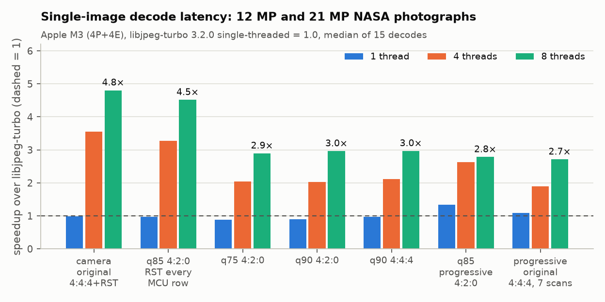
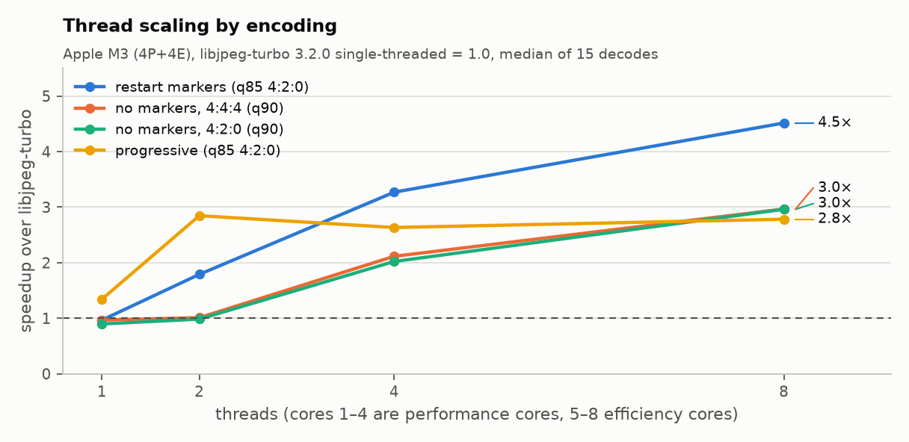

# parajpeg

**A parallel JPEG decoder whose output is byte-identical to libjpeg-turbo, for baseline and progressive
images, with or without restart markers.** C++20, with scalar, NEON, AVX2 and CUDA backends.

[](https://github.com/anniigr/parajpeg/actions/workflows/ci.yml)

On an Apple M3 laptop (8 cores), a 21-megapixel photograph decodes 2.9–4.7× faster than
single-threaded libjpeg-turbo. Every pixel is identical to libjpeg-turbo's, on every backend and
thread count, and the test suite checks that on every commit.



## Why this is not trivial

JPEG decoding has one stage that resists parallelism: Huffman decoding. A scan is a single bitstream,
code boundaries are unknown until everything before them has been decoded, DC coefficients are
differences from the previous block, and progressive images build each coefficient over several
scans. Once IDCT and colour conversion are vectorised, this stage dominates latency.

The usual workaround is restart markers, but most images have none. parajpeg parallelises all of them:

| image kind | how the entropy-coded data is decoded in parallel |
|---|---|
| restart markers | independent intervals |
| baseline, no markers | **speculative self-synchronising decoding**: workers start at arbitrary bytes, and their states are reconciled at fine-grained checkpoints (CPU) or by Jacobi iteration (GPU) |
| progressive, first scans | the same speculation, with an extended decoder state (end-of-band runs, MCU phase) |
| progressive, DC refinement | bit-indexed: one bit per block, so block *n* reads bit *n* |
| progressive, AC refinement | provably sequential; instead **pipelined** behind its predecessor scan block by block, and decoded with nonzero-coefficient bitmasks |

The full reasoning, including what didn't work, is in **[docs/design.md](docs/design.md)**.

## Results

21 MP and 12 MP NASA photographs (public domain), each re-encoded five ways plus the camera
original. Times are the median of 9 decodes, Apple M3 (4 performance + 4 efficiency cores), macOS,
Apple clang 21, libjpeg-turbo 3.2.0 with accurate DCT. libjpeg-turbo has no intra-image parallelism,
so it is single-threaded.

| encoding (21 MP) | libjpeg-turbo | parajpeg 1 thread | parajpeg 8 threads | speedup |
|---|---:|---:|---:|---:|
| camera original (4:4:4, restart markers) | 42.8 ms | 45.0 ms | 9.1 ms | 4.7× |
| q90 4:2:0 | 33.1 ms | 38.5 ms | 11.5 ms | 2.9× |
| q90 4:4:4 | 42.2 ms | 45.8 ms | 14.7 ms | 2.9× |
| q85 4:2:0, restart every MCU row | 37.1 ms | 40.3 ms | 8.5 ms | 4.4× |
| q85 progressive | 101.4 ms | 76.3 ms | 33.8 ms (2 threads) | 3.0× |



What the numbers show:

* **Restart markers** scale almost linearly. The camera originals reach 2.3 Gpixel/s.
* **Baseline without markers** gains nothing from 2 threads, then about 3× at 8. Speculation decodes
  roughly twice (discover, then decode), so its ceiling is about P/2 on P cores. parajpeg switches
  speculation off below three threads, which is where it stops paying.
* **Progressive** single-thread decoding is already 1.3× faster than libjpeg-turbo, thanks to
  bitmask-driven refinement. Its parallel speedup is capped by the luma AC refinement scan, which
  cannot be parallelised: how many bits a block consumes depends on that block's history. Pipelining
  the two luma refinement scans brought progressive decodes from 47.5 ms to 33.8 ms, measured against
  the previous commit with the same benchmark (`bench/results/baseline-v0`).
* **Many small images** (24 Kodak images, 8 workers, one image per worker) reach 0.95× of
  libjpeg-turbo's throughput. This is the data-loader case where intra-image parallelism doesn't
  apply, and it measures single-core efficiency.

Full tables, including per-stage times and 12 MP results: [bench/results/results.md](bench/results/results.md).

## Correctness

Bit-exactness is the contract, so it is tested more heavily than anything else.

* **Oracle:** a 71-image corpus covers odd sizes, 4:4:4, 4:2:2, 4:2:0, 4:4:0, 4:1:1 and grayscale,
  restart intervals, optimised tables, and progressive. Every image is compared byte-for-byte with
  TurboJPEG for every backend, thread count and output format.
* **Forced strategies:** a test option pushes every scan through its parallel strategy, with
  subsequences as small as 64 bytes, and asserts that the strategy was actually used.
* **GPU algorithm on any machine:** the CUDA source avoids shared memory and `__syncthreads`, so it
  also compiles for a CPU grid emulator. The emulated GPU pipeline passes the same bit-exactness
  suite, with 32-byte subsequences to stress synchronisation.
* **SIMD:** NEON and AVX2 kernels equal the 64-bit scalar reference for all inputs, adversarial ones
  included, through proven overflow bounds with guarded fallbacks. 200,000 random blocks per run;
  AVX2 runs on Linux x86-64 and under Rosetta 2.
* **Damaged files:** 252 truncated streams, cut at 30–97% of their length, are compared byte-for-byte
  with libjpeg-turbo's recovery output. parajpeg reproduces libjpeg's out-of-data rules: the current
  MCU is completed with zero bits, the rest of the restart interval is skipped, and the flag
  survives restarts that leave a marker unread. It also reproduces libjpeg's interblock smoothing
  for progressive images with incomplete coefficients. Damaged data can make IDCT outputs overflow,
  and there libjpeg-turbo's SIMD and C paths disagree. parajpeg follows the C reference, so these
  tests run against it (`JSIMD_FORCENONE=1`). Damaged progressive files reproduce libjpeg-turbo
  3.x, whose recovery differs from 2.x.
* **Robustness:** libFuzzer, ASan, UBSan and ThreadSanitizer. The fuzzer found two real bugs. A stray
  marker inside entropy data made a bit-position estimate stall, which hung the GPU kernels. RST
  markers in an image without restart intervals were treated as part of the scan, although libjpeg
  stops there. Both inputs are now regression tests. The scan pipeline is lock-free and TSan-clean.
  One data race appeared during development, as a failing bit-exactness test, and the scheduler's
  dependency rule now rules it out.
* **Real files:** NASA camera originals (Nikon, EXIF, restart markers) and a 30 MB, 7-scan
  progressive original decode bit-exactly.

## CUDA backend

`src/cuda/gpu_decoder.cu` implements massively parallel speculative Huffman decoding, following
Weißenberger & Schmidt (HiPC 2021) and extended with MCU-phase tracking for interleaved scans. The
kernels are:

* initial decode, then Jacobi synchronisation rounds;
* sync-free segmented prefix sums for block offsets and DC predictors;
* a final decode;
* a restart-interval kernel;
* the shared islow IDCT;
* per-pixel fancy upsampling and colour conversion.

Progressive scans are entropy-decoded by the CPU engine and reconstructed on the GPU.

**Status, stated plainly:** the kernels compile with CUDA 13.4 for sm_75 through sm_120 in CI (ptxas:
28–40 registers per entropy kernel), and their algorithm is verified bit-exact in
the emulator. They have **not yet been benchmarked on NVIDIA hardware**, because this was developed
on a laptop without one. The next step is a rented A100/L4 session: compare against nvJPEG (CUDA and
hardware paths) and the HiPC 2021 throughput figures, profile with Nsight Compute, and tune the
subsequence size.

## Build

```bash
brew install jpeg-turbo            # or: apt install libturbojpeg0-dev   (test oracle + benchmark baseline)
cmake -S . -B build -DCMAKE_BUILD_TYPE=Release
cmake --build build -j
ctest --test-dir build             # bit-exactness, SIMD equivalence, emulated GPU
./build/pjdec photo.jpg out.ppm    # prints per-stage timings; PJ_SCANS=1 shows the scan schedule
```

`-DPARAJPEG_WITH_CUDA=ON` builds the GPU backend. Benchmarks: `bench/make_corpus.sh && bench/run_all.sh`.

```cpp
#include <parajpeg/parajpeg.h>

parajpeg::DecodeOptions opts;          // RGB, all cores, Backend::Auto
parajpeg::Image img;
parajpeg::DecodeStats stats;
parajpeg::Status s = parajpeg::decode(data, size, opts, img, &stats);
```

## Layout

| path | contents |
|---|---|
| `src/core/parser.cpp` | marker parser, Huffman table construction (incl. fast AC table) |
| `src/core/entropy.cpp` | scan DAG scheduler, speculative / restart / bit-indexed / pipelined decoders |
| `src/core/bitreader.h` | bit reader with canonical bit positions |
| `src/common/idct_core.h` | libjpeg islow IDCT shared by the CPU and GPU |
| `src/cpu/` | NEON and AVX2 kernels, runtime dispatch |
| `src/cuda/` | CUDA kernels, host pipeline, CPU grid emulator runtime |
| `tests/`, `fuzz/` | test suites and fuzz target |
| `bench/` | benchmark driver, corpus script, plots, results |

## Limitations

* 8-bit sequential and progressive Huffman JPEG only. Arithmetic coding, 12-bit, lossless and
  hierarchical JPEG are rejected with `Unsupported`.
* Output is the full image only: no scaled decoding, no cropping.
* CMYK/YCCK images require a 4-channel output format.

## References

* S. T. Klein, Y. Wiseman. *Parallel Huffman decoding with applications to JPEG files.* The Computer
  Journal 46(5), 2003.
* A. Weißenberger, B. Schmidt. *Massively Parallel Huffman Decoding on GPUs.* ICPP 2018;
  *Accelerating JPEG Decompression on GPUs.* HiPC 2021.
* libjpeg-turbo (`jdhuff.c`, `jdphuff.c`, `jidctint.c`, `jdsample.c`, `jdcolor.c`), the reference
  semantics reproduced here.
* ITU-T T.81 (JPEG), Annexes C, F and G.

Test images: NASA Johnson Space Center crew Earth observations (public domain) and the Kodak
Lossless True Color Image Suite. They are downloaded by `bench/make_corpus.sh` and not redistributed.

MIT licence.
