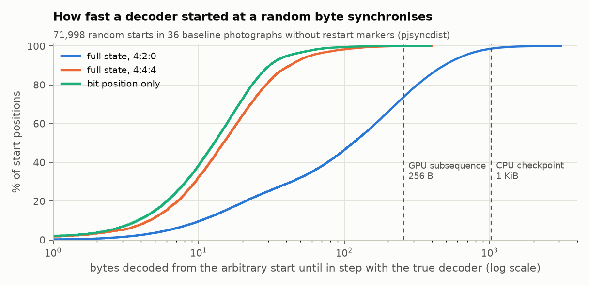

# Benchmarks

All numbers in this repository come from the scripts in [`bench/`](../bench) and are stored in
[`bench/results/`](../bench/results). This page gives the methodology, the full results and how
to read them. There are no GPU measurements: the CUDA backend has not been run on NVIDIA hardware
([gpu.md](gpu.md)).

## Setup

| | |
|---|---|
| machine | MacBook Air, Apple M3: 4 performance + 4 efficiency cores, 16 GB, macOS 27.0.1 (Darwin 27.0.0), running on battery |
| compiler | Apple clang 21.0.0, `-O3`, CMake `Release`. No `-march` flags: NEON is baseline on arm64 |
| baseline | libjpeg-turbo 3.2.0 (Homebrew), TurboJPEG `tjDecompress2` with `TJFLAG_ACCURATEDCT`, RGB output, one thread |
| parajpeg | `Backend::Cpu` (NEON) with 1, 2, 4 and 8 threads; also `Backend::Scalar` (no SIMD, one thread) |
| output | RGB (grayscale for grayscale files) into a preallocated buffer; both libraries produce identical bytes |
| timing | wall time of one complete decode (headers to pixels). One warm-up decode, then the **median of 15** |
| harness | [`bench/pjbench.cpp`](../bench/pjbench.cpp), driven by [`bench/run_all.sh`](../bench/run_all.sh) |

**Why single-threaded libjpeg-turbo.** libjpeg-turbo has no way to decode one image with several
threads, so for single-image latency its single-threaded time is the reference point. This is
*not* a claim that parajpeg is faster than every alternative configuration. An application
decoding many images can run one libjpeg-turbo per core, and that case is measured separately
(batch mode, below), where parajpeg is slightly slower.

**Test images.** Four public-domain NASA photographs from the ISS crew Earth observations
(5568×3712 or 5566×3712 = 20.7 MP for three of them, 4032×3024 = 12.2 MP for the fourth), each in the version
NASA distributes plus five re-encodings made by libjpeg-turbo's `cjpeg`
([`bench/make_corpus.sh`](../bench/make_corpus.sh)):

| name | encoding | entropy decoding strategy used by parajpeg |
|---|---|---|
| `camera` | as distributed: three Nikon originals (4:4:4, restart marker every MCU row) and one 7-scan progressive 4:4:4 file | restart-parallel / scan DAG |
| `q75_420`, `q90_420` | baseline 4:2:0, optimised Huffman tables, no restart markers | speculative |
| `q90_444` | baseline 4:4:4, optimised tables, no restart markers | speculative |
| `q85_420_rst` | baseline 4:2:0, restart marker every MCU row (`-restart 1`) | restart-parallel |
| `q85_prog` | progressive 4:2:0, `cjpeg -progressive` default script (10 scans) | scan DAG |

The images are downloaded and re-encoded by the script, not redistributed. The batch test uses the
24 Kodak images (768×512) encoded at q90 4:2:0.

## Results: single-image latency

Median of 15, milliseconds. "Best" is the best parajpeg time over 1–8 threads, divided into
libjpeg-turbo's time. Raw data: [`results.md`](../bench/results/results.md),
[`latency.json`](../bench/results/latency.json).

| image | encoding | MP | libjpeg-turbo | parajpeg scalar | 1 thread | 2 | 4 | 8 | best speedup |
|---|---|---:|---:|---:|---:|---:|---:|---:|---:|
| iss062e001866 | camera, 4:4:4 + RST | 20.7 | 41.98 | 112.20 | 45.19 | 23.28 | 12.19 | 9.10 | **4.62×** |
| | q75 4:2:0 | 20.7 | 30.91 | 89.61 | 36.36 | 32.76 | 15.46 | 10.79 | 2.87× |
| | q85 4:2:0 + RST | 20.7 | 37.03 | 95.21 | 40.51 | 21.61 | 11.70 | 8.41 | **4.40×** |
| | q85 progressive | 20.7 | 100.99 | 128.09 | 74.99 | 33.97 | 36.93 | 35.22 | 2.97× |
| | q90 4:2:0 | 20.7 | 33.02 | 93.50 | 38.63 | 35.00 | 16.61 | 11.49 | 2.87× |
| | q90 4:4:4 | 20.7 | 41.97 | 112.66 | 45.76 | 43.58 | 20.28 | 14.41 | 2.91× |
| iss063e062018 | camera, 4:4:4 + RST | 20.7 | 44.41 | 109.76 | 45.31 | 23.82 | 12.52 | 9.24 | **4.81×** |
| | q75 4:2:0 | 20.7 | 32.49 | 89.66 | 37.03 | 33.31 | 15.67 | 10.85 | 3.00× |
| | q85 4:2:0 + RST | 20.7 | 40.32 | 96.35 | 42.24 | 22.82 | 12.47 | 9.12 | **4.42×** |
| | q85 progressive | 20.7 | 106.53 | 131.30 | 78.98 | 36.07 | 38.72 | 36.10 | 2.95× |
| | q90 4:2:0 | 20.7 | 34.83 | 93.36 | 39.01 | 35.36 | 16.75 | 11.58 | 3.01× |
| | q90 4:4:4 | 20.7 | 43.55 | 110.12 | 45.32 | 42.77 | 20.13 | 14.21 | 3.07× |
| iss069-e-089946 | camera, progressive 4:4:4, 7 scans, 29 MB | 20.7 | 209.15 | 323.00 | 191.10 | 86.90 | 110.01 | 77.14 | 2.71× |
| | q75 4:2:0 | 20.7 | 54.61 | 129.81 | 57.30 | 53.54 | 26.94 | 19.72 | 2.77× |
| | q85 4:2:0 + RST | 20.7 | 68.77 | 143.40 | 67.82 | 35.35 | 18.68 | 12.75 | **5.39×** |
| | q85 progressive | 20.7 | 190.61 | 244.93 | 170.85 | 87.83 | 95.63 | 91.76 | 2.17× |
| | q90 4:2:0 | 20.7 | 74.98 | 151.27 | 75.14 | 71.04 | 37.34 | 25.07 | 2.99× |
| | q90 4:4:4 | 20.7 | 101.23 | 216.36 | 104.07 | 101.08 | 50.70 | 35.06 | 2.89× |
| iss074e0458251 | camera, 4:4:4 + RST | 12.2 | 27.09 | 63.37 | 27.54 | 14.27 | 7.52 | 5.57 | **4.87×** |
| | q75 4:2:0 | 12.2 | 20.88 | 53.49 | 23.30 | 21.12 | 10.18 | 7.14 | 2.92× |
| | q85 4:2:0 + RST | 12.2 | 25.85 | 57.77 | 26.48 | 14.26 | 7.82 | 5.61 | **4.61×** |
| | q85 progressive | 12.2 | 70.84 | 82.67 | 52.97 | 25.86 | 27.97 | 26.26 | 2.74× |
| | q90 4:2:0 | 12.2 | 22.15 | 55.91 | 24.60 | 22.50 | 10.88 | 7.55 | 2.93× |
| | q90 4:4:4 | 12.2 | 27.01 | 63.35 | 27.60 | 26.20 | 12.51 | 8.94 | 3.02× |

Summary by encoding (range over the four photographs):

| encoding | best speedup | parajpeg 1 thread vs libjpeg-turbo |
|---|---|---|
| restart markers (camera originals and `-restart 1`) | 4.4–5.4× | 0.91–1.01× |
| baseline without restart markers | 2.8–3.1× | 0.85–1.00× |
| progressive | 2.2–3.0× | 1.09–1.35× |

## Results: many small images (throughput)

24 Kodak images (9.4 MP in total), 8 workers, each worker decodes whole images on one thread. This
is the data-loader situation where parallelism inside an image is not needed.

| workers | libjpeg-turbo | parajpeg | images/s (turbo) | images/s (parajpeg) | ratio |
|---:|---:|---:|---:|---:|---:|
| 8 | 4.6 ms | 4.9 ms | 5,229 | 4,920 | 0.94× |

## Reading the results

**Restart markers scale almost linearly.** Intervals are independent, so every thread decodes
whole intervals with no extra work. The 21 MP camera originals decode in 9.1–9.2 ms
(2.3 Gpixel/s). The scaling from 4 to 8 threads is weaker than from 1 to 4 because cores 5–8
are efficiency cores.

**Without markers, 2 threads gain nothing, then speedups reach ~3× at 8.** The speculative
decoder does the Huffman work about twice (discover, then decode; [design.md §3](design.md#3-speculative-self-synchronising-entropy-decoding)),
so its ceiling on P cores is about P/2. With two threads it would only break even, so the
scheduler disables speculation below three threads. The 2-thread column above shows the
consequence: the entropy stage runs sequentially, and only the colour stage is parallel.

**Progressive images are fastest with 2 threads.** The 10-scan `cjpeg` script ends with two
luma AC-refinement scans that must be decoded sequentially. In the per-scan trace of an 8-thread
decode (`PJ_SCANS=1 pjdec`), each takes about 24 ms and they overlap almost completely through
pipelining, while the whole entropy stage takes about 30 ms. More threads cannot shorten that
chain. Extra threads mainly add contention, and above 4 threads they include efficiency
cores. Pipelining was measured against the previous commit with the same harness
([`baseline-v0`](../bench/results/baseline-v0/results.md)): the best progressive time for
iss062e001866 went from 47.5 ms to 34.0 ms.

**Single-thread efficiency.** With one thread, parajpeg is 0–15% slower than libjpeg-turbo on
baseline images and 9–35% faster on progressive ones. The baseline gap is in Huffman decoding,
where libjpeg-turbo's long-tuned decoder is faster. The progressive advantage comes from the
bitmask-driven AC refinement ([design.md §4](design.md#4-progressive-jpeg)). The scalar column
(no SIMD) shows what the NEON kernels contribute: 2.0–2.5× on baseline images.

**Where the time goes at 8 threads.** On the q90 4:2:0 21 MP image, about 9.5 ms of the 11.5 ms
is entropy decoding (with fused IDCT) and 1.8 ms is upsampling and colour conversion. Entropy
decoding remains the bottleneck, which is why the rest of the design focuses on it.

## Run-to-run variation

The laptop is not an isolated benchmark machine. An earlier 9-run pass on the same commit
reproduced every figure above to within a few percent, except for single outliers: one
camera-original row measured 18.5 ms at 8 threads instead of 9.2 ms, presumably because of
scheduling or thermal interference. The published table is the 15-run pass, run with no other
load. Treat differences below ~5% as noise.

## Synchronisation distance

Speculative decoding depends on one empirical property: a decoder started at an arbitrary byte
quickly falls into step with the true decoder. [`bench/syncdist.cpp`](../bench/syncdist.cpp)
(`pjsyncdist`) measures this directly. It decodes the scan sequentially and records the state at
every block boundary. Then, from 2,000 evenly spaced start offsets per image, it decodes exactly as
pass 1 of the parallel decoder does: empty state, MCU phase guessed from the byte offset. For each
start it reports the distance until the decoder's state equals a true state.



36 baseline images without restart markers (12 NASA re-encodings, 24 Kodak), 71,998 starts.
Summary: [`syncdist.md`](../bench/results/syncdist.md).

| | median | 99th percentile | maximum |
|---|---:|---:|---:|
| bit position only | 6–21 B | 20–171 B | 392 B |
| full state, 4:4:4 | 12–26 B | 50–176 B | 400 B |
| full state, 4:2:0 | 48–314 B | 344–1,912 B | 3,099 B |

Two of the 72,000 starts (both in kodim01) did not synchronise before the end of the scan. The
parallel decoder stays correct in that case: the correction pass simply continues decoding
sequentially until the end of the group.

What this shows:

* **Bit alignment is fast:** a few dozen bytes. That is the Huffman self-synchronisation that
  Klein and Wiseman described.
* **The MCU phase is what costs.** In a 4:2:0 MCU of six blocks (four luma, two chroma), a decoder
  that guessed the wrong block-in-MCU slot keeps producing plausible symbols. Only a decoding
  divergence that shifts its block count by the right amount brings the phase into line. So for
  4:2:0, the median full synchronisation takes 6–15 times longer than bit alignment.
* **Consequence for the CPU decoder:** with 1 KiB checkpoints, the correction pass usually
  re-decodes one checkpoint per group, occasionally two or three. This matches the `sync`
  counts in the per-scan trace: for example, 31 groups and 31 re-decoded checkpoints on q90 4:2:0.
* **Consequence for the GPU decoder:** its default 256-byte subsequences are shorter than the
  4:2:0 phase-synchronisation distance in about a quarter of cases. In the emulator this costs 3–15
  Jacobi rounds on 4:2:0 images, against 1–2 for 4:4:4. One image reached 15 rounds, one below the
  limit where the host switches to the single-threaded fallback. With 1 KiB subsequences the same
  images need 1–4 rounds. See [gpu.md](gpu.md#synchronisation-by-jacobi-iteration). This is
  the first parameter to tune on hardware. A structural alternative is to decode each subsequence
  for every possible MCU phase.

## Reproducing

```bash
brew install jpeg-turbo                       # or apt install libturbojpeg0-dev libjpeg-turbo-progs
cmake -S . -B build -DCMAKE_BUILD_TYPE=Release && cmake --build build -j
bench/make_corpus.sh                          # downloads ~50 MB; ~400 MB in bench/data/ after re-encoding
RUNS=15 bench/run_all.sh                      # latency + batch + sync distance -> bench/results/
bench/check_bitexact.sh bench/data/jpg/*.jpg  # pjdec vs djpeg, byte for byte
python3 bench/plot.py                         # figures -> docs/img/ (needs matplotlib)
```
